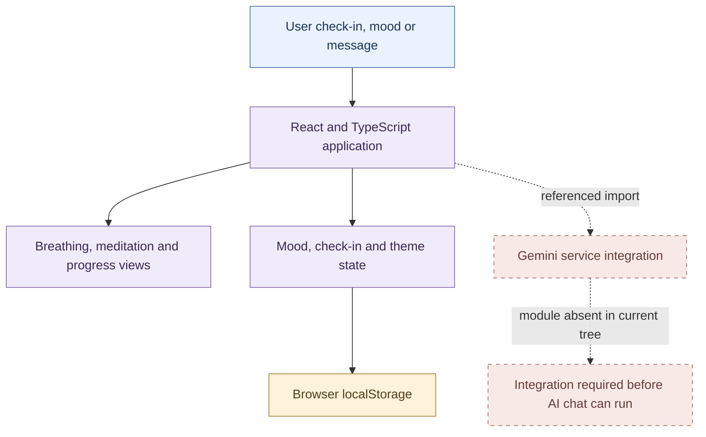

# Aura: Your Wellness Companion

A calming, supportive space and app designed to help users with mindfulness, stress relief, and overall wellness.

---

## 🏗️ System Architecture

The checked-in UI includes local wellness tools and browser storage. `App.tsx` imports `getAIResponse` and `getPlaylist` from `components/services/geminiService`, but that module is not present in the current repository tree. The dashed path identifies the unresolved AI integration instead of presenting it as a working hosted service.

<strong>Follow the implementation</strong>

| Stage | Source |
| --- | --- |
| Application orchestration | [App.tsx](App.tsx) |
| Chat display | [components/ChatWindow.tsx](components/ChatWindow.tsx) |
| Mood persistence | [utils/moodStorage.ts](utils/moodStorage.ts) |
| Declared dependencies | [package.json](package.json) |

## ✨ Features

- Calming user interface with minimal distractions.  
- Guided breathing, meditation, or other wellness exercises.  
- UX “quiet space” loader or splash screen while the app initializes.  
- Personalized routines / progress tracking (optional).  
- (You can add: notifications, reminders, soundscapes, mood tracking, etc.)

---

## 🛠️ Tech Stack

- Frontend: Web app (HTML, CSS, JavaScript / React / Vue / etc.)  
- Backend / Hosting: Deployed to Google Cloud Run.  
- Data storage / State management: (e.g., Firestore / SQLite / local storage)  
- (Optional: any third-party APIs or libraries, e.g., for guided meditation audio, analytics.)

---

---

## About the developer

Built by **Pallavi Vholgade**. Explore my AI / ML projects, experience, and skills in my [portfolio](https://pallavi-portfolio-preview.vercel.app).

[LinkedIn](https://www.linkedin.com/in/pallavi-vholgade-05565b24b) · [Email](mailto:pallavivhalgade@gmail.com)
